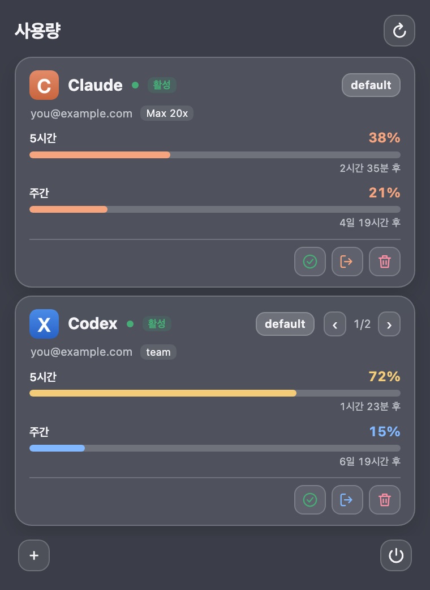

# Usagi

A macOS menu bar app that shows Claude Code and Codex usage limits (5-hour, weekly and more) and when they reset, for each of your accounts.
Add several accounts as cards and pick which one new terminals use.
The name is Japanese for rabbit (うさぎ), and sounds a bit like "usage".

## Install

```sh
brew install --cask extransload/tap/usagi
open -a Usagi
```

Needs macOS 14 or later and the Claude Code or Codex CLI ([requirements](#requirements)). Usagi comes from its own Homebrew tap, so `brew search usagi` won't list it until the tap is added; the command above adds it for you.



- A rabbit icon or your usage percentages appear in the menu bar: one per service (Claude, Codex), for the account marked **Active** (or the service's first card when that account is hidden). Click it to open the account cards; right-click it for **Refresh Now**, **Check for Updates**, **Menu Bar Shows** (how many services before a "+N", from 1 up to the services you have; the largest also covers services added later), **Also Use in Apps** and **Quit Usagi**.
- To start Usagi when you log in, add it under **System Settings > General > Login Items**.
- Usagi is not signed or notarized by Apple. So that it opens right away, the Homebrew install removes the macOS quarantine flag. That skips Apple's check, so install it only if you trust this repository. From 1.0.3 on, every release zip is built by GitHub Actions and can be checked with `gh attestation verify` ([SECURITY.md](SECURITY.md)).

## Update and uninstall

When you open the menu, Usagi checks GitHub for a newer release (at most every 6 hours) and asks whether to update. The bottom of the menu shows your version and whether it is up to date; click it to check right away. With a Homebrew install, **Update** runs `brew update` and `brew upgrade --cask extransload/tap/usagi` in the background and reopens Usagi. Only one update runs at a time; the output goes to `~/.config/usagi/update.log`, and if the update hasn't finished after 11 minutes the menu says so and offers to retry. A copy built from source opens the release page instead. To be notified by email, use **Watch > Custom > Releases** on the GitHub repository.

By hand:

```sh
brew upgrade --cask usagi            # update
brew uninstall --cask usagi          # remove the app
brew uninstall --zap --cask usagi    # also remove ~/.config/usagi and Usagi's caches, preferences and web view data
```

Zap does not touch your Claude Code and Codex profiles (`~/.claude*`, `~/.codex*`) or their sign-ins.

## Requirements

| Item | Details |
|---|---|
| macOS | 14 Sonoma or later, Apple Silicon or Intel |
| CLI | [Claude Code](https://docs.anthropic.com/en/docs/claude-code) (`claude`), [Codex CLI](https://github.com/openai/codex) (`codex`), or both |
| Python | `/usr/bin/python3`, which comes with the Xcode Command Line Tools (already installed if you use Homebrew) |
| Browser | Sign-in opens in Google Chrome when it is installed, otherwise in your default browser |
| Shell | Account switching for new terminals works in zsh and bash |

Apps opened from Finder or at login get a short `PATH`, so Usagi looks for the CLIs itself, in this order: `PATH`, `~/.local/bin`, `/opt/homebrew/bin`, `/usr/local/bin`, `/opt/local/bin`, `~/.npm-global/bin`, `~/.bun/bin`, `~/.volta/bin`, `~/.claude/local`, `~/Library/pnpm`, `~/.yarn/bin`, `~/.asdf/shims`, `~/.local/share/mise/shims`, then the newest nvm and fnm Node versions. If none of these has it, Usagi asks your login shell (`$SHELL -ilc 'command -v claude'`) when you press refresh, sign in or add an account, and remembers the answer; background refreshes never start your shell. CLIs installed with npm run with their own Node, even when Node isn't on the app's `PATH`.

## Usage

- On first launch, the CLI accounts you are already signed in to appear as cards. With none, the menu tells you what to install or offers **Add account**.
- **＋** then Claude or Codex adds an account card. Usagi shows a hidden existing account if there is one; otherwise it creates a new profile such as `account-2` (`~/.claude-account-2`, `~/.codex-account-2`).
- The sign-in button opens the official CLI sign-in in your browser. While it is open the card shows **Waiting for sign-in in your browser…** and the button becomes **Reopen sign-in**; if sign-in fails or times out (after 10 minutes), the card says why. On a signed-in card the same button is **Sign in again**.
- When a service has several accounts, flip through them with **‹ ›** at the top right of the card, a horizontal trackpad swipe, or the arrow keys. Accounts are shown by email (an account that isn't signed in yet is "Account 2" and so on; hover to see its profile folder). The account you had before Usagi comes first, and the account new terminals use is marked **Active**.
- **Use in new terminals** (✓) picks that account for new terminals. To make it take effect, add this line to `~/.zshrc` (or `~/.bashrc`). It applies to `claude` and `codex` runs started afterwards, including new tmux panes; sessions already running keep their account.

  ```sh
  for usagi in /Applications ~/Applications; do [[ -r $usagi/Usagi.app/Contents/Resources/usagi.zsh ]] && { source $usagi/Usagi.app/Contents/Resources/usagi.zsh; break; }; done
  ```

  To have apps use it too (anything that runs Claude Code or Codex underneath, such as editor extensions and the Codex desktop app), turn on **Also Use in Apps** in the right-click menu. Usagi then sets `CLAUDE_CONFIG_DIR` and `CODEX_HOME` (`launchctl setenv`, no admin rights) for apps and background jobs you start from now on; reopen apps that are already open, also after you switch accounts. Chat logins in the Claude and ChatGPT apps, and tools that keep their own sign-in, aren't affected. Turning it off puts back any other value that was set before (a profile folder such as `~/.codex-work` counts as Usagi's). The setting lasts until you log out, even if you quit Usagi, and Usagi sets it again when it starts after you log in, so turn the option off before uninstalling Usagi.

- **Hide** (the crossed-out eye) only hides the card. The account stays signed in and keeps its profile folder; add it back with **＋**.
- Each limit shows when its reading was taken (**Updated 4m ago**) and when the limit resets. A reading that may be out of date says so, and a limit that has reset since the last reading shows **Reset** until the CLI reports a new value.
- Drag a service's card by its header to change the order, or press ⌥↑ / ⌥↓ inside it. The menu bar uses the same order.
- The menu grows to fit your cards and only scrolls when they are taller than the screen.
- Usagi refreshes every minute while the menu is open and every 5 minutes while it is closed, and pauses while the display sleeps. When the numbers in the menu bar are not up to date they are dimmed; hover over them to see why. Only one copy of Usagi runs at a time.

## What Usagi reads

- **Claude**: the usage cache Claude Code keeps in `~/.claude.json` (`~/.claude-<name>/.claude.json` for extra accounts). Only percentages and reset times are read. Claude Code refreshes that cache itself, so a reading can be hours old; Usagi marks a 5-hour reading older than 30 minutes, or any other reading older than 3 hours, as possibly out of date. Dollar credits listed in the same cache, such as the cloud-session credit for Max and Pro, are shown with what's left and when they expire. Sign-in state comes from `claude auth status`.
- **Codex**: Usagi asks the Codex CLI's official app-server (`codex app-server`) for the account and its limits. Limits are named by the period Codex reports (Team: 5-hour and weekly, Free: 30-day, and so on). Free limit resets Codex granted you are listed on the card with their expiry dates.
- Usagi never reads or copies sign-in tokens. Sign-in uses `claude auth login` and the Codex app-server's own sign-in.
- **Icons**: card and menu bar icons come from the Claude and ChatGPT apps when they are installed. If the Claude app isn't installed, Usagi downloads Claude's icon from claude.ai (PNG only, at most 1 MB, again after 30 days) and keeps it in `~/.config/usagi/icons`. Without either, Usagi shows plain C and X badges.
- **Network**: apart from the CLIs it runs, Usagi itself only contacts `api.github.com` for the update check and claude.ai for that icon.
- **Files Usagi writes**, all in `~/.config/usagi`: the card list (`cards.json`), the account new terminals use (`state/`), sign-in markers and the last sign-in error (`logins/`), where it found the CLIs (`cli-paths.json`, `cli-paths.lock`), the Claude icon (`icons/`), and the last update's output (`update.log`, `update.lock`). New profiles are the folders `~/.claude-<name>` and `~/.codex-<name>`, which link to your shared settings, skills and hooks in `~/.claude` and `~/.codex`. A `settings.json` that carries credentials (an API key, `apiKeyHelper`, or Bedrock, Vertex or AWS settings), or that Usagi can't read, is not linked, so each account signs in on its own.
- With the same account, the Claude apps, claude.ai and Claude Code share limits. Codex limits can also be shared with other Codex use on the same ChatGPT account.

## Troubleshooting

| Problem | What to do |
|---|---|
| macOS says Usagi can't be opened | Open **System Settings > Privacy & Security** and click **Open Anyway**, or run `xattr -dr com.apple.quarantine /Applications/Usagi.app`. This happens when the zip was downloaded by hand or the cask's quarantine step failed. |
| The menu says the Command Line Tools are missing | Run `xcode-select --install`. Major macOS upgrades sometimes remove them. |
| A card says the CLI was not found | Install the CLI, or check that it is in one of the folders under [Requirements](#requirements). If you moved it, delete `~/.config/usagi/cli-paths.json`. |
| The rabbit isn't in the menu bar | On a Mac with a notch, other menu bar items can hide it; quit some, or on macOS 26 and later check **System Settings > Menu Bar**. |
| Sign-in stays on "Waiting for sign-in in your browser…" | Finish or close the browser tab. Sign-in gives up after 10 minutes; click **Reopen sign-in** to start over. |
| Claude numbers look old | Run Claude Code once; it refreshes the cache Usagi reads. |
| **Update** didn't finish | Read `~/.config/usagi/update.log`, then run `brew upgrade --cask extransload/tap/usagi` in Terminal. |
| A new terminal uses the wrong account | Check that the `usagi.zsh` line is in `~/.zshrc` or `~/.bashrc`, and open a new terminal. |

Report other problems in [Issues](https://github.com/Extransload/usagi/issues); the bug report form lists what to include.

## Tested environment

Checked on the developer's Mac on 2026-10-21.

| Item | Version |
|---|---|
| macOS | 27.0.1 (26A434), Apple Silicon |
| Claude Code | 2.1.305 |
| Codex CLI | 0.163.0 |
| Python | 3.9.6 (`/usr/bin/python3`); the tests also run on 3.11.9 |
| Swift | 6.4 (built in Swift 5 language mode) |
| Homebrew | 7.0.10 |

Checked:

- 100 Python tests, 218 Swift checks, and 277 checks of the menu page in a real WebKit view in light and dark mode, with no script errors or Content Security Policy violations
- Reading Claude Max 20x, Codex Team and Codex Free accounts with the short `PATH` an app opened from Finder gets
- A CLI installed the npm way (a `#!/usr/bin/env node` script next to its own `node` under `~/.nvm`, simulated with a stand-in CLI) found and run without Node on `PATH`
- Starting with an empty home folder: no cards, an onboarding card, and the bridge's answers for signed-out and missing CLIs
- Bridge time limits: a hung CLI is stopped and its child processes are cleaned up
- The build: arm64 and x86_64, minimum macOS 14.0, ad-hoc signature with hardened runtime
- CI on GitHub: tests, build, bundle checks, a bridge snapshot and a launch on macOS 14, 15 and 26 and on an Intel runner
- Updating from 1.0.2 to 1.0.3 with the **Update** button on this Mac: Homebrew quit Usagi, replaced it and reopened it

Not checked yet:

- Using the menu on a real Intel Mac or on macOS 14, 15 or 26 (CI only builds and launches it there)
- Sign-in on a Mac without Chrome (the default-browser fallback is covered by automated tests only)

## Agent Kit users

If you use Agent Kit (`~/.config/iterm2/agentkit`), which keeps Claude Code and Codex accounts in the same profile folders, Usagi shares its state folder and profile marker (`.agentkit-profile`), and profiles Usagi creates carry both markers. Agent Kit's own shell hook already handles account selection, so you don't need `usagi.zsh`.

## Install from source

Needs the Xcode Command Line Tools (`xcode-select --install`), which provide `swiftc` to build Usagi and `/usr/bin/python3` to run it. Don't combine a source install with the Homebrew install: `install.sh` stops if the cask is installed (run `brew uninstall --cask usagi` first).

```sh
git clone https://github.com/Extransload/usagi.git
cd usagi
./install.sh
```

This builds Usagi, installs it to `~/Applications/Usagi.app` and registers a LaunchAgent (`~/Library/LaunchAgents/io.github.extransload.usagi.plist`) so it starts when you log in. To update, run `git pull` and `./install.sh` again; in a source install the in-app **Update** opens the release page. Add `--dry-run` to see what it would do without changing anything.

To remove it:

```sh
./install.sh --uninstall
```

This removes the app and the LaunchAgent. Your cards and settings in `~/.config/usagi` are kept; delete that folder to remove them, and remove the `usagi.zsh` line from your shell profile if you added it.

## Development

```sh
./build.sh                                      # build/Usagi.app (arm64 + x86_64) from Sources/*.swift
/usr/bin/python3 -m unittest discover -s tests  # the app runs Apple's Python 3.9
tests/swift/run.sh                              # Swift unit checks
./make-icon.sh                                  # only after editing the SVGs in assets; needs Google Chrome
```

CI (`.github/workflows/ci.yml`) runs the tests, builds and checks the app, and launches it on macOS 14, 15 and 26 and on an Intel runner.

### Releasing

Releases are built by GitHub Actions, not on a developer's Mac. Add a `## X.Y.Z` section to `CHANGELOG.md` and push it to `main`, then run:

```sh
./release.sh --check X.Y.Z   # optional rehearsal: checks and tests, changes nothing
./release.sh X.Y.Z
```

`release.sh` runs the tests, bumps `Info.plist`, then tags `vX.Y.Z` and pushes. The tag starts the Release workflow, which builds the universal app on a GitHub-hosted macOS runner, checks it, attests its build provenance and uploads the zip to a draft release. `release.sh` then verifies the zip and its attestation and publishes the release, points the cask in [Extransload/homebrew-tap](https://github.com/Extransload/homebrew-tap) at the new version, and only then marks the release as latest, so the in-app update check never offers a version Homebrew can't install yet.

If a step fails, fix the cause and run the same command again; finished steps are skipped. It needs the GitHub CLI (`gh`) signed in with push access to both repositories. See [docs/RELEASING.md](docs/RELEASING.md) for each step, resuming and rollback.

## License

[MIT](LICENSE)

Claude is a trademark of Anthropic. Codex and ChatGPT are trademarks of OpenAI. Usagi is an unofficial app and is not affiliated with either company.
